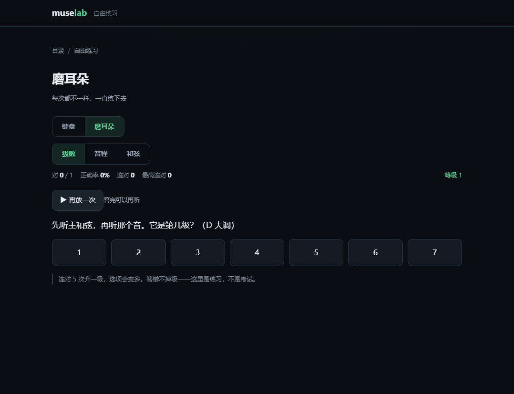
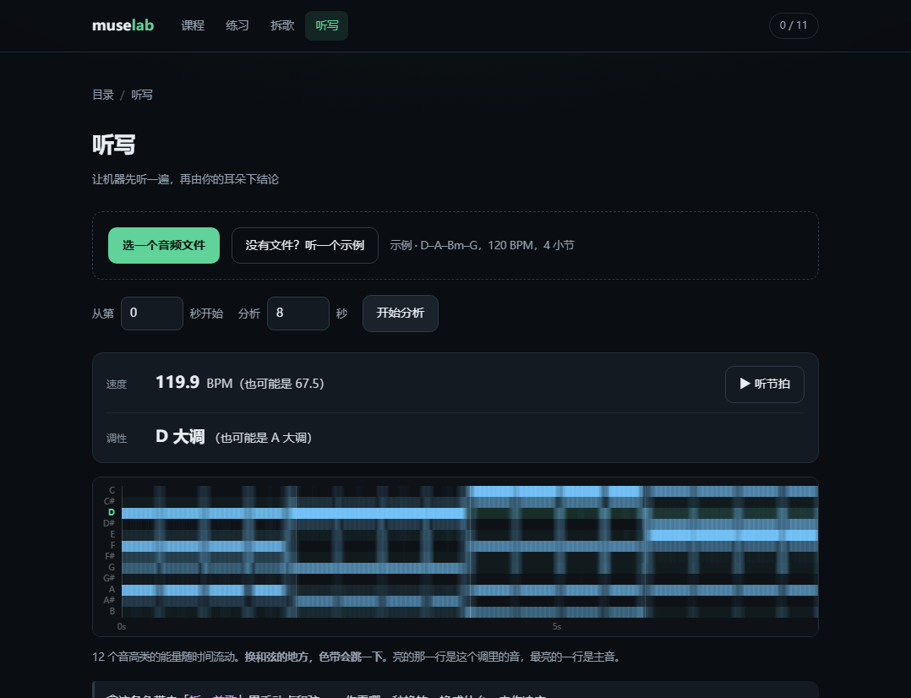
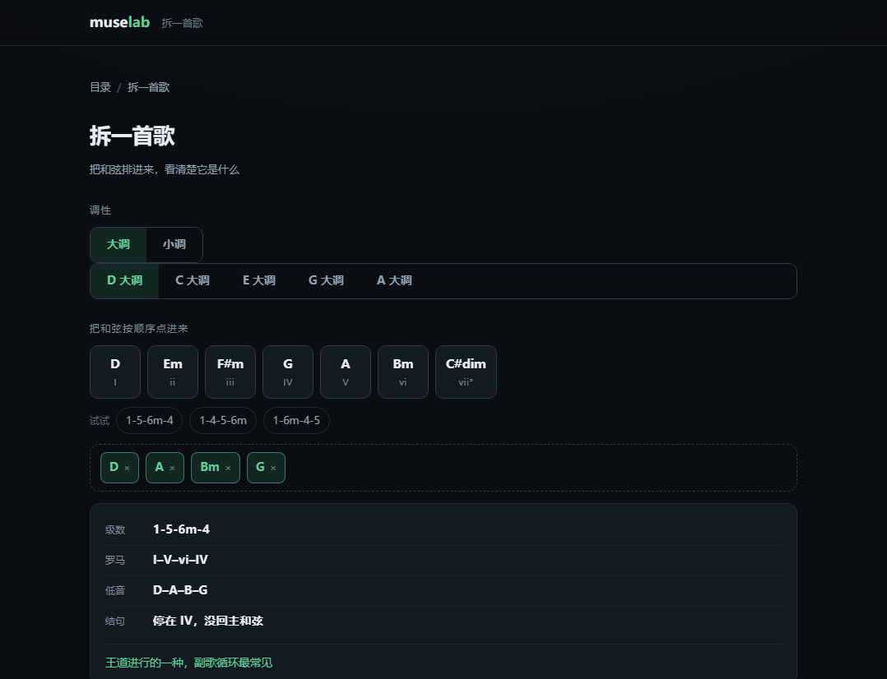

# muse lab

给写 Vocaloid 的人用的练习站。一课只干一件事：**先听，再动手，然后换一道新题。**

十一课能走完：

- **第 1 课「它结束了没有」** —— 不用乐理词，听出「落地」的那一下
- **第 2 课「薄的和厚的」** —— 主歌和副歌的差别是「更满」，不是「更响」
- **第 3 课「最低那条线」** —— 把注意力放到贝斯上，听出歌往哪走
- **第 4 课「只有 1 和 5」** —— 从听出「落」，到摆出自己的 4 小节，到导出一个能拖进 Studio One 的 `.mid`
- **第 5 课「配一句哼唱」** —— 在那 4 小节上写一条旋律，强拍必须落在和弦音上，导出的 **Vocal 轨里有音了**
- **第 7 课「换个家」** —— 同一组音，重心挪到 A 小调：i–VI–III–VII
- **第 8 课「换一个顺序」** —— 同一组四个和弦排出六种进行，网站认得出你排的是哪一种，导出 8 小节
- **第 10 课「两小节一句」** —— 给旋律加呼吸：句尾空拍、每句一个长音、第二句不许照抄第一句
- **第 11 课「进软件」** —— 这里网站判不了，给一张 Studio One 的清单，做一条勾一条
- **第 12 课「加一个鼓」** —— 八分踩镲不停、底鼓 1、3、军鼓 2、4，导出的 `.mid` 里多一条 **Drums** 轨
- **第 13 课「主歌和副歌」** —— 同一个鼓摆两套密度：主歌 half-time 沉住，副歌打开

前三课不碰软件、不出现乐理名词，只有一个动作：**听，然后选**。

另外还有一个反向的工具：**「拆一首歌」** —— 把和弦打进去，它告诉你是 `1-5-6m-4` 还是 `i–VI–III–VII`。学会写之后，回头听懂别人怎么写。


**▶ 在线版：<https://harukafreeze.github.io/muse-lab/>**（手机也能开，戴着耳机练）

**▶ 本地打开：双击 `index.html`**（无构建、无后端、断网可用。也可以 `python -m http.server 8080` 再开 `127.0.0.1:8080`）

---

## 一课长什么样

**第 1 课**，三步，全是听：

| 步 | 干什么 | 判分吗 |
| --- | --- | --- |
| 1 | 听两个结尾：同样的和弦、同样的速度，只有一个真的结束了 | 不用答 |
| 2 | 再来一次，选出结束的那一段 | 判 |
| 3 | 说明：你刚才听的是「和声有没有回到主和弦」，跟名字无关 | 不用答 |

**第 2 课**，三步：

| 步 | 干什么 | 判分吗 |
| --- | --- | --- |
| 1 | 听同一段 4 小节：薄（无鼓）vs 厚（有鼓） | 不用答 |
| 2 | 选出更像副歌的那一段 | 判 |
| 3 | 副歌变大靠的是「多出来的元素」，不是推子 | 不用答 |

**第 3 课**，四步：

| 步 | 干什么 | 判分吗 |
| --- | --- | --- |
| 1 | 只听最低那条线，用「嗯」哼出来 | 不用答 |
| 2 | 讲为什么低音决定方向 | 不用答 |
| 3 | 听一段没见过的，判断往上还是往下 | 判 |
| 4 | 交给第 4 课：这条线以后由你排 | 不用答 |

**第 4 课**，六步：

| 步 | 干什么 | 判分吗 |
| --- | --- | --- |
| 1 | 听 8 小节：6 小节 D → 1 小节 A → 回到 D | 不用答 |
| 2 | A/B 两版只差和弦顺序，选哪一版「没回家」 | 判 |
| 3 | 讲为什么 A 不安定（C# 离 D 差半个音） | 不用答 |
| 4 | 在卷帘上摆 4 小节，只许用 D 和 A | 判 |
| 5 | 听一段 8 小节，数 A 出现几次 | 判 |
| 6 | 导出 `.mid` | — |

**第 5 课**，五步：

| 步 | 干什么 | 判分吗 |
| --- | --- | --- |
| 1 | 听「和弦 + 一句已经写好的旋律」 | 不用答 |
| 2 | 听两个版本：第 1 拍拍 E（不在 D 里）vs 拍 A | 不用答 |
| 3 | 在 4×4 的格子上摆 16 个音，强拍必须是和弦音 | 判 |
| 4 | 听一段，找出哪一小节第 1 拍踩在了和弦外 | 判 |
| 5 | 导出——这次旋律写进 **Vocal 轨** | — |

**第 7 课**，四步：

| 步 | 干什么 | 判分吗 |
| --- | --- | --- |
| 1 | 听 Am–F–C–G，同样是 C 大调那七个音，重心换了 | 不用答 |
| 2 | 听两段同音集的进行：C 大调 vs A 小调 | 不用答 |
| 3 | 自己摆一段小调：首小节固定 Am，六选三 | 判 + 报出是哪个进行 |
| 4 | 导出 8 小节（调号 0 个升降，调式 minor） | — |

**第 8 课**，六步：

| 步 | 干什么 | 判分吗 |
| --- | --- | --- |
| 1 | 听 1-5-6m-4 走两遍（D–A–Bm–G） | 不用答 |
| 2 | A/B 两版：1564 vs 1645，选哪一版落到了 Bm | 判 |
| 3 | 讲两种进行的方向差别 | 不用答 |
| 4 | 自己排：只许这四个和弦，首小节固定 D，末小节不许是 D | 判 + **报出这是哪个进行** |
| 5 | 听一段，认出最后停在哪个和弦 | 判 |
| 6 | 导出 8 小节（你的 4 小节放两遍） | — |

**第 10 课**，五步：

| 步 | 干什么 | 判分吗 |
| --- | --- | --- |
| 1 | 听一句有呼吸的示范（第 2、4 小节末尾各空一拍） | 不用答 |
| 2 | 听两个版本：一口气唱完 vs 有空拍 | 不用答 |
| 3 | 写两句：句尾必须空拍、每句至少一个两拍长音、两句收尾不能一样 | 判 |
| 4 | 听一段，找出只在哪一小节换了气 | 判 |
| 5 | 导出 8 小节——和弦和旋律都放两遍 | — |

**第 11 课**，三步，没有判分：

| 步 | 干什么 |
| --- | --- |
| 1 | 讲清楚：网站到这儿停了 |
| 2 | 六条 Studio One 清单，做一条勾一条 |
| 3 | 写一句「我最不满意的是 ______」 |

**第 12 课**，五步：

| 步 | 干什么 | 判分吗 |
| --- | --- | --- |
| 1 | 听同一段和声：没鼓 vs 有鼓 | 不用答 |
| 2 | 听两个版本：八分踩镲 vs 四分踩镲 | 不用答 |
| 3 | 摆鼓：八格踩镲全亮，底鼓第 1 拍，军鼓第 2、4 拍 | 判 |
| 4 | 听一段，指出哪一排整小节一直在响 | 判 |
| 5 | 导出 8 小节——多一条 **Drums** 轨 | — |

**第 13 课**，四步：

| 步 | 干什么 | 判分吗 |
| --- | --- | --- |
| 1 | 听 4 小节：全用主歌型 vs 前 2 后 2 换套 | 不用答 |
| 2 | 听 half-time：军鼓只在第 3 拍，听起来「沉」 | 不用答 |
| 3 | 摆两套鼓（两个页签），副歌必须比主歌密至少 2 下 | 判 |
| 4 | 导出 8 小节：主歌主歌副歌副歌 | — |

---

## 自由练习

首页最下面第二张卡。没有「过关」，只有统计——想练哪块练哪块。

**键盘**：两个八度、25 个键。鼠标、触屏、电脑键盘（`A W S E D F T G Y H U J K`）都能弹；按几个键就是几个音，所以能自己按出和弦。切到「级数」显示，每个键上会标出它在这个调里是第几级，调外的标成 `·`——第 4 课说的「在琴上弹出 1 和 5」，终于有琴可弹了。

下面还有这个调的七个和弦，点一下听整组。

**磨耳朵**：三种题型，每次现生成，答案也是现算的。

| 题型 | 问什么 |
| --- | --- |
| 级数 | 先给主和弦，再给一个音，说它是第几级（相对音感的核心） |
| 音程 | 两个音差多少，从小二度到八度 |
| 和弦 | 大三、小三、减三、增三 |
| 按和弦 | 给你一个和弦名，在键盘上把它按出来——听到的和按出来的对上，才算真的会 |

连对 5 次升一级，选项变多。**答错不掉级**——这里是练习，不是考试。正确率、连对、每个题型的最高连对都存在本地。

**哼唱**：对着麦克风哼一句，它把音高一个个抓下来，画成一条线，再给你一串音符。

- 音高检测用 YIN（累积均值归一化差分），先把输入降采样到 12kHz 再算，够快也够准
- 抓到的音会按 0.09 秒的门限合并成音符，导出的 `.mid` 只有一条 Vocal 轨，拖进 Studio One 就是一条能改的旋律
- 音频不上传，全部在本地处理



---

## 听写

传一段音频，机器先听一遍。它**不会**给你「第 3 小节是 Bm」——和弦识别在密集混音上只有六七成准，错了又看不出来，那正是这个站最不能犯的错。

它给三样你能自己验证的东西：

| 读出来 | 怎么验证 |
| --- | --- |
| **速度** | 旁边有个「听节拍」，跟着数就知道对不对 |
| **调性** | 一次给两个候选，因为关系大小调本来就分不清 |
| **和弦色带** | 12 个音高类的能量随时间流动，换和弦的地方会跳一下 |

然后拿着色带去「拆一首歌」里手动点和弦——**哪一秒换的、换成什么，由你决定**。



全部在浏览器里算，音频不上传、不落盘。速度检测用的是频谱通量 + 自相关，再加一个偏向 90–160 BPM 的先验（不然后期歌很容易被测成半速）。

## 拆一首歌

首页「随手用」里的第二张卡。选调性 → 点和弦 → 立刻得到一张卡：

```
级数  1-5-6m-4
罗马  I–V–vi–IV
低音  D–A–B–G
结句  停在 IV，没回主和弦
王道进行的一种，副歌循环最常见
```

认不出来的进行也照常显示级数和低音，只是不编名字——名字只是方便你跟别人说，听才是目的。

三个预设会按当前调和调式展开。大调是 1564 / 1645 / 卡农；切到小调变成 `i–VI–III–VII` / `i–iv–VII–III` / `i–VII–VI–V`，换到 C 小调就展开成 `Cm Ab Eb Bb`——降号调里用降号写，不会写成 `D#`。



---

## 七个不显眼但决定成败的设计

**1. A/B 切换走采样级时钟，不在点击时重新触发。**

两版**永远同时排在同一条时间线上**，各自一个 gain 总线；切换只改 gain，并且 `setTargetAtTime` 精确落在大节线上。

如果每次点击才重建振荡器，两次之间会有几毫秒抖动和相位差——学习者听到的「差别」里就掺了非音乐因素，这道题当场失效。而且从界面上完全看不出来。`tools/self-test.js` 里专门盯这一条。

**2. 答案一律现算，不写死在课程数据里。**

课程数据只存原料（调、和弦、旋律），正确答案由 `theory.js` 算：
`endsOnTonic()` 算哪一版没落回主和弦，`barsWithDegree()` 数第 5 级出现几次，
`offStrongBeats()` 找哪一小节的强拍踩在了和弦外，`lastChord()` 认最后停在哪儿。

自检脚本会**独立重算一遍**来对账。这是整个站能不能信的全部依据——判据写反了，界面上看着一切正常，只是安静地教错人。

**3. 声音现场合成，但「好不好听」也要能被量出来。**

铺底是左右两把失谐锯齿 + 中间三角波，低通带包络；混响的脉冲响应是现场生成的噪声（1.9 秒指数衰减），不引任何音频文件；旋律带延迟颤音，听起来才像有人在唱。鼓也是合成的：底鼓是正弦从 118Hz 滑到 42Hz，军鼓是带通噪声加一点 186Hz 的体，踩镲是高通噪声 50 毫秒就没。

听感没法自动判，但**「响的是不是那些音」可以**：`browser-test.js` 用 `OfflineAudioContext` 把声音渲染成 PCM，跑 Goertzel 量各频率的能量——D3 / F#3 / A3 的能量是非和弦音 C4 的 200 倍以上，才允许通过。

踩镲是噪声，单点测不出能量，所以换个办法：渲染两遍（有踩镲 / 没踩镲），8kHz 的能量要差 2 倍以上。实测差 14 倍。

**4. 导出的 `.mid` 是「拿来就能挂声库」的。**

Type-1 三条轨：`Chords`、`Bass`、`Vocal`；第 12 课以后多一条 `Drums`（第 10 通道，通用 MIDI 打击乐 36 / 38 / 42）。第 5 课导出的 `Vocal` 轨里已经写好了音高和节奏，拖进 Studio One 直接在上面建 VOCALOID6，只差填词。

**4.5 大调和小调走同一套代码，只是音阶表不同。**

`MODES` 里两条数组：大调 `[0,2,4,5,7,9,11]`，自然小调 `[0,2,3,5,7,8,10]`。级数、和弦、罗马数字全从这张表推出来，所以第 7 课和拆歌工具的小调模式没有一行重复逻辑。

罗马数字的大小写**跟着和弦性质走**，不跟着调式走：A 小调里出现 E 大三和弦（和声小调的 V），显示成 `V` 而不是 `v`——耳朵听到的才是真的。

**5. 强拍那几行会亮起来。**

第 5 课的格子里，当前小节的和弦音那几行铺了一层淡绿底。初学者最大的困难不是不会写，是不知道该看哪儿——这跟数独站里「把无关的行列压暗」是同一个思路。

**6. 你排出来的进行，网站叫得出名字。**

第 8 课的六种排法全部收录在 `PROG_NAMES` 里：排成 D–A–Bm–G，它会说「这是 1-5-6m-4，王道进行的一种，副歌循环最常见」。认不出来就老实返回 `null`，不硬编。

自检里有一条专门守这个：**六种合法排法必须全部有名字**。加新和弦、改约束时，这条会立刻告诉你命名表漏了。

**7. 范例必须通过它自己教的规则。**

第 10 课的示范旋律 `PHRASE_10` 会被自检拿去跑一遍 `checkMelody()`——示范自己不成立，就说明规则写错了或者示范写错了。

反向也测：把两处换气拍填上，必须被判不通过；把两句收尾改成同一个音，也必须被判不通过。**一条规则如果拦不住故意写坏的例子，它就是装饰。**

---

## VOCALOID 的边界

网站里不会有人唱歌，这是设计，不是没做完。

VOCALOID6 Editor 是 Windows 桌面程序 + VST3，没有 web SDK，声库授权也不允许把 GUMI 的声音放进网页。所以网站和 DAW 之间只能是 `.mid` + 规格单——而这正好是学习者本来就要走的那条路。

同理，「写出一首自己的曲子」网站判不了。所以完成度不定义成「通过测验」，而定成产物：一个 `.mid` + 你摆的和弦 + 你放上去的那句旋律。

---

## 文件结构

```
web/
├── index.html
├── css/style.css       全部样式（深色、单一强调色）
├── js/
│   ├── theory.js       音名 / 和弦 / 级数 / 调号 / 大小调（纯函数，可 node 直测）
│   ├── audio.js        合成引擎 + 走带 + A/B 双总线 + 混响 + 鼓 + 离线渲染入口
│   ├── midi.js         SMF Type-1 编码器（手写，无依赖）
│   ├── pianoroll.js    钢琴卷帘（摆和弦）+ 旋律网格（摆音）+ 节奏格子（摆鼓）
│   ├── lessons.js      课程数据 + 判分规则 + 认进行
│   ├── progress.js     localStorage 存档
│   └── app.js          路由 / 界面 / 交互
├── docs/preview/       README 里的截图
└── tools/
    ├── self-test.js    内核自检（乐理、课程、MIDI、走带、鼓、出题、DSP），261 项
    ├── browser-test.js 端到端（CDP 驱动无头 Chrome，含离线音频分析），121 项
    └── shots/          测试自动生成的截图
```

普通 `<script>`，不是 ES module——这样 `file://` 双击打开不会被 CORS 拦住。

```powershell
node tools/self-test.js      # 约 1 秒
node tools/browser-test.js   # 需要本机 Chrome，约 20 秒
```

端到端默认测本地的 `file://`。想直接测线上站，给它一个地址：

```powershell
$env:MUSE_BASE = "https://harukafreeze.github.io/muse-lab/"
node tools/browser-test.js
```

---

## 发布

**已经在线：<https://harukafreeze.github.io/muse-lab/>**

这个目录就是一个完整的静态站，没有构建步骤。仓库是 [harukafreeze/muse-lab](https://github.com/harukafreeze/muse-lab)，Pages 走 `main` / `/ (root)`。

以后改完只要推一次，Pages 自己重建，一分钟左右生效：

```powershell
git add -A
git commit -m "……"
git push
```

> 刚推完的那一两分钟，CDN 可能还在发旧文件。想立刻验证就带个缓存参数：
> `$env:MUSE_BASE = "https://harukafreeze.github.io/muse-lab/?v=1"`

`.nojekyll` 在根目录——没有它，Jekyll 会吞掉一些以下划线开头的路径。

<details>
<summary>第一次建站用的命令（留档）</summary>

```powershell
cd web
git init -b main
git add -A
git commit -m "muse lab: 八节课 + 拆歌工具"
git remote add origin https://github.com/harukafreeze/muse-lab.git
git push -u origin main
```

然后在仓库 **Settings → Pages** 里选 `main` / `/ (root)`。
</details>

---

## 想改什么，改哪儿

| 想做的事 | 改哪里 |
| --- | --- |
| 换和弦、加一课 | `js/lessons.js` 的 `steps` 数组，加一个对象就行 |
| 判分松紧 | `ML.checkBuild()` / `ML.checkMelody()` |
| 音色太闷 / 太亮 | `js/audio.js` 里 `pad()` 的 `cutoff` 和 `envelope()` 的包络 |
| 混响多少 | `A.play` 里 `send.gain.value`（默认 0.2） |
| 音量 | `MA.play({ level, melLevel })`，默认 0.1 / 0.14 |
| 导出内容 | `MM.fromProgression()` |
| 卷帘音区 | `js/pianoroll.js` 的 `LOW` / `HIGH`；旋律音板在课程数据的 `palette` |

改完 `theory.js` 或 `lessons.js`，**一定要跑一次 `self-test.js`**。

---

## 已知边界

- 十一课：1、2、3、4、5、7、8、10、11、12、13。第 6 课（加 4）和第 9 课（加 6m）的内容已经被第 8 课吸收，没单独做。
- 拆歌只处理调内的七个和弦，转调、借用和弦、七和弦都认不出级数；小调只做自然小调，和声小调的 V 会显示成 `V` 但不在音板里。
- 没有账号、没有云端，进度只在这台机器上。清缓存前没做导出备份。
- 第 5 课只允许 6 个音（D4 E4 F#4 A4 B4 D5），也每人每拍一个音——这一版故意限制，先把「强拍落和弦音」练成条件反射。
- 第 10 课的换气点固定在第 2、4 小节的第 4 拍。真实演唱里换气位置要看歌词，这里先做死。
- 鼓只有 8 个八分格，做不出 16 分音符的碎拍。主歌 / 副歌的切换也固定成 2+2，真歌通常是 8+8。
- 手机外放听不出低音，第 1 屏就写了「戴耳机」。
- 谱面不显示五线谱，只有格子——先练耳朵。
